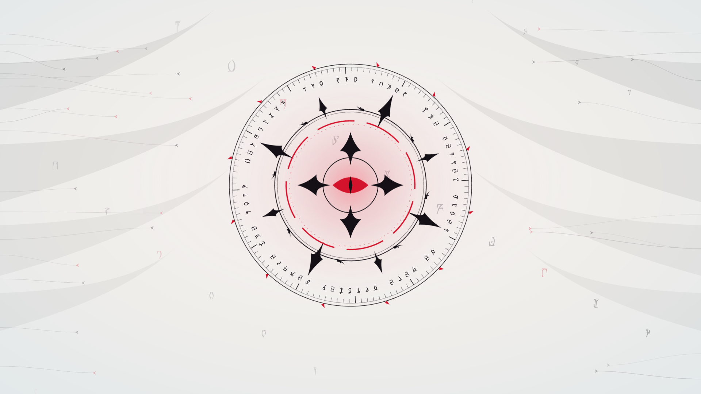
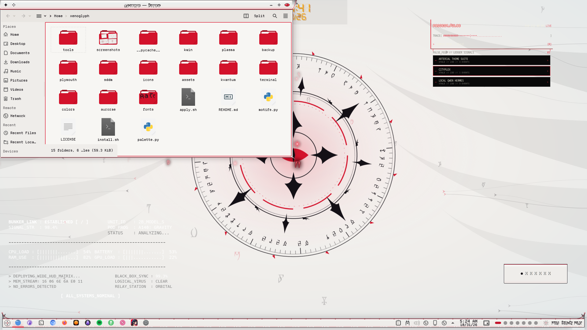

# Xenoglyph — Animated Wallpaper

A living Daedric sigil: counter-turning rings of script, a red eye that pulses and blinks, drifting glyphs and a red scan beam, on one 20 fps clock.



Xenoglyph is an alien-white, cybertribal look for KDE Plasma 6: pearl and bone surfaces, black tribal ink that sweeps into fins, horns and claws, a red ichor seam through everything, Daedric script, and motion everywhere.

## Features

- Counter-turning rings of Daedric script around black tribal thorns and a red eye that pulses and blinks.
- Glyphs drift slowly upward, and a faint red scan beam sweeps across.
- Everything runs on one 20 fps clock and pure QtQuick (about a tenth of one CPU core on a ThinkPad).
- Also works as the lock screen wallpaper.
- `still/` is the same art as a plain image wallpaper, for zero CPU.



## Requirements

Plasma 6.

## Install

```bash
git clone https://github.com/numbpill3d/xenoglyph-wallpaper
cd xenoglyph-wallpaper && ./install.sh
```

Or from the KDE Store: Animated: extract `animated/` to `~/.local/share/plasma/wallpapers/scorn.xenoglyph` and pick **Xenoglyph (animated)** in Desktop and Wallpaper. Still: extract `still/` to `~/.local/share/wallpapers/Xenoglyph`.

## The rest of the suite

| piece | repo |
|---|---|
| SDDM login | [xenoglyph-sddm](https://github.com/numbpill3d/xenoglyph-sddm) |
| Plymouth boot splash | [xenoglyph-plymouth](https://github.com/numbpill3d/xenoglyph-plymouth) |
| Global theme + splash screen | [xenoglyph-global](https://github.com/numbpill3d/xenoglyph-global) |
| Plasma style (panel, popups) | [xenoglyph-plasma](https://github.com/numbpill3d/xenoglyph-plasma) |
| Aurorae window decoration | [xenoglyph-aurorae](https://github.com/numbpill3d/xenoglyph-aurorae) |
| Floating runes (KWin script) | [xenoglyph-runes](https://github.com/numbpill3d/xenoglyph-runes) |
| Window open/close animation (KWin effect) | [xenoglyph-unfurl](https://github.com/numbpill3d/xenoglyph-unfurl) |
| Sigil clock widget | [xenoglyph-sigil](https://github.com/numbpill3d/xenoglyph-sigil) |
| Colour scheme | [xenoglyph-colors](https://github.com/numbpill3d/xenoglyph-colors) |
| Kvantum widget style | [xenoglyph-kvantum](https://github.com/numbpill3d/xenoglyph-kvantum) |
| Icon theme | [xenoglyph-icons](https://github.com/numbpill3d/xenoglyph-icons) |
| Konsole + kitty colours | [xenoglyph-konsole](https://github.com/numbpill3d/xenoglyph-konsole) |

Everything at once, with the generators: [xenoglyph](https://github.com/numbpill3d/xenoglyph).

## Tags

`xenoglyph` `kde` `kde-plasma` `plasma6` `light-theme` `white` `red` `cybertribal` `tribal` `alien` `daedric` `otherworldly` `animated` `wallpaper` `wallpaper-plugin` `live-wallpaper` `sigil` `lock-screen`

## Credits and licence

By splicer scorn (voidrane). GPL-3.0-or-later.
